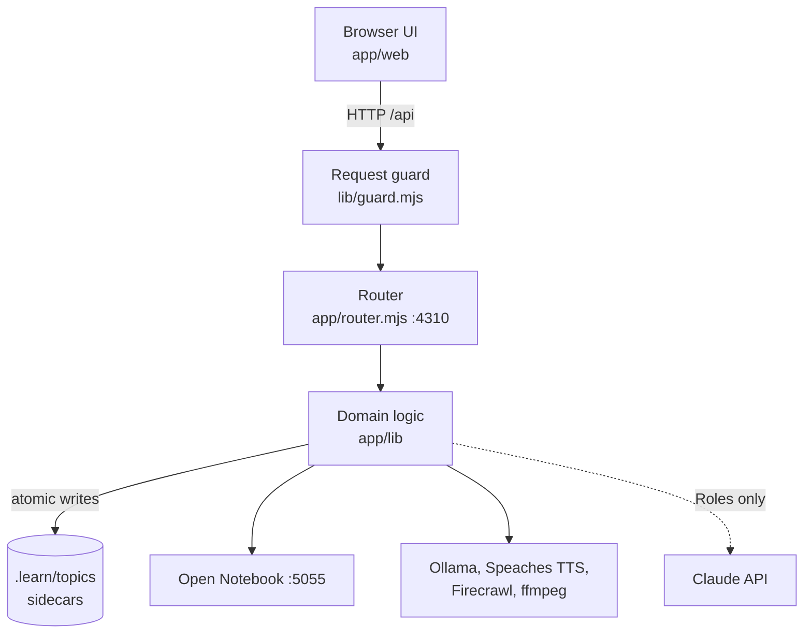

# StudyDeck

A personal deep-dive study system. Point it at a topic and it builds a curriculum,
tracks what you actually know, quizzes you, and renders podcasts and video overviews from the source
material.

Single-user, local-only, zero runtime dependencies. Built to learn *with*, not to ship.

---

## Quick start

Needs **Node 22 or newer** and nothing else. Not 20: the suite uses the test runner's
glob expansion (Node 21+) and `fs.globSync` (22+), so on 20 it does not run at all. Node
20 goes end of life on 2026-04-30 (`v20.end` in
[nodejs/Release](https://github.com/nodejs/Release/blob/main/schedule.json)).

```bash
npm start
```

Serves the cockpit at **http://127.0.0.1:4310** — loopback only, by design.

```bash
npm test
```

Runs the suite with `node --test`. There is no build step, no bundler, and nothing to
install: `app/` uses only the Node standard library on the server and vanilla ES modules
in the browser. `npm test` passes with `node_modules` deleted entirely — that's the
invariant, and it's worth keeping. CI runs it on Linux against Node 22 and 24 with **no
install step**, because a passing suite with no dependencies present is what proves the
invariant rather than merely asserting it.

```bash
npm run verify
```

A read-only integrity check of the learning data — corrupt sidecars, torn JSONL lines,
temp files left by a crashed write. Exit `0` clean, `1` damaged, `2` could not check.
Worth running before a study session, since a damaged file otherwise shows up as *fewer
cards* rather than as an error.

## What's in here

| Path | What it is |
|---|---|
| `app/` | The cockpit — entrypoint (`server.mjs`), routes (`router.mjs`), logic (`lib/`), browser UI (`web/`) |
| `.learn/topics/<slug>/` | Curriculum state, owned by learn-anything and its schema |
| `.learn/topics/<slug>/cockpit/` | Sidecars this project owns — attempts, cards, schedule, practice, teach-back evidence, role-session outcomes and diagnoses |
| `.learn/topics/<slug>/cockpit/transcripts/` | Role-session conversations. **Ignored by git** — kept on this machine only |
| `tasks/` | Design docs. `study-flow.md` and `study-cockpit-plan.md` are authoritative |
| `learnings/` | Notes from solved problems, one file per hard-won lesson |
| `docs/` | The [Sources and media guide](docs/sources-and-media.md), per-change records in `docs/changes/`, the architecture map in `docs/diagrams/`, and ignored local tutorial recordings and generated/imported MP4s |
| `ops/firecrawl/` | Local Firecrawl/SearXNG deployment overlay and setup instructions |
| `.claude/`, `.agents/` | Slash commands and vendored learn-anything skills |
| `.github/workflows/` | CI — the suite on Node 22 and 24 plus the integrity check (`test.yml`), a secret scan (`secret-scan.yml`) and the AI review gate (`ai-review.yml`) |
| `bin/`, `scripts/`, `lefthook.yml` | PR-gate tooling (`bin/`, from the sovereign-forge kit) and local git-hook gates (`lefthook.yml` runs the guards in `scripts/`: secrets, big files, staged binaries) |

## Architecture



### System map

<!-- archify:start -->


Interactive: [`docs/diagrams/studydeck.architecture.html`](docs/diagrams/studydeck.architecture.html)
— search, trace routes, compare roles. Source of truth is the typed IR
[`studydeck.architecture.json`](docs/diagrams/studydeck.architecture.json); edit that, never the HTML.
<!-- archify:end -->

## Topics are pluggable

The system is topic-agnostic. Each notebook's curriculum lives under
`.learn/topics/<slug>/`; the configured notebook list is in
`app/cockpit.config.json`.

Use **+ New** in the notebook rail to create another notebook. StudyDeck creates
the matching Open Notebook notebook and a valid, empty topic directory, then selects
it. Ask your learning agent to build its curriculum after you have added sources.
Nothing in `app/` is specific to any subject.

To add material, select the notebook, open **Reading Room**, and choose **+ Add
source**. Links and pasted text can be added there. For PDFs and other files, use
the **Upload a PDF or file in Open Notebook** link in the same form and choose the
matching notebook. Open Notebook processes new sources asynchronously; use
**Refresh sources** in the Reading Room to see them when ready.

For internet research, enter a topic or sentence in **Search the internet** on the
Sources screen. Results can include websites, PDFs, YouTube videos, blogs, vendor
documentation, and training sites. Local assessment ranks a bounded set of retrieved
excerpts. Review the explanation and caveats before choosing **Use this source**,
then **Add to notebook**. Searching alone does not import anything.

The search shows an activity indicator and elapsed time. It can take several minutes;
the timer indicates an active request, not a measured percentage complete. Preliminary
results and incomplete coverage are labeled. See the [Sources and media guide](docs/sources-and-media.md)
for the full workflow, PDF login help, podcast filters, and video instructions.

## Studying

Slash commands drive the learning loop, backed by the skills in `.claude/skills/`:

| Command | What it does |
|---|---|
| `/learn:topic` | Initialize or load a topic; view the knowledge map |
| `/learn:explain` | Recursive deep-dive into a concept |
| `/learn:practice` | Hands-on practice — real files for code topics, discussion for conceptual ones |
| `/learn:quiz` | Q&A quiz; generates and persists a reusable deck |
| `/learn:review` | Spaced-repetition review and recommendations |
| `/learn:status` | Mastery heatmap |

Quiz decks are served to the browser **answer-free** and graded server-side. That isn't
incidental — if answers reached the client before submit, the pretest baseline would be
meaningless.

## External services

All optional in the sense that the cockpit degrades honestly when they're unreachable —
it reports the outage rather than inventing a result.

| Service | Where | Used for |
|---|---|---|
| Open Notebook | API `127.0.0.1:5055`, UI `127.0.0.1:8502` | Sources, file uploads, notes, podcast generation |
| Ollama | `localhost:11434` | Grading, card generation, video scripts, and source assessment |
| Firecrawl CLI and local API | `127.0.0.1:3002` | Internet search and page extraction through SearXNG |
| Speaches / Kokoro | `127.0.0.1:8969` | Local text-to-speech for podcasts and video narration |
| librsvg and FFmpeg | Local executables | Slide images and MP4 assembly for video overviews |
| Claude API | `api.anthropic.com` | The **Roles** view: Interviewer, Socratic questioner, Sparring partner, Diagnostician |

**Roles is the one part of the cockpit that leaves this machine.** It sends what you type
in a session, short excerpts from the topic's sources, the names of concepts you have
missed and your confirmed interview summary to Anthropic's Claude API. A diagnosis also
sends questions you got wrong, what you answered and the correct answer. It never sends a
question you have not attempted. Full conversations stay in the ignored `transcripts/`
directory; what is committed is that a session happened, what it cost, a summary you
confirm, and diagnosis findings.

Cards made from a session are the exception that stays local: you write the answer side,
or ask for a draft, and that draft comes from the **local Ollama model**, never the Claude
API. A draft arrives locked and labelled; **Edit the draft** unlocks it. The label says
whether your Open Notebook sources went into it, or that it was made without them. Each
card records whether its answer was yours, an AI draft, or an AI draft you edited.

Roles is off until the process that starts the cockpit gives it
`STUDYDECK_ANTHROPIC_API_KEY`. The server reads it from its environment once at boot and
from nowhere else. Create the key under a **workspace** in the Anthropic Console: an
organization-wide key is refused with a 400 asking for a workspace id.

**The always-on cockpit** is a LaunchAgent (`com.jamescruce.studydeck`), and launchd never
reads your shell profile, so an `export` in `~/.zshrc` does not reach it. The plist runs
`~/.config/studydeck/start-cockpit.sh`, which starts the server under Proton Pass:

```bash
pass-cli run --env-file ~/.config/studydeck/secrets.env -- node app/server.mjs
```

`secrets.env` holds a `pass://` reference, not the key, so nothing secret is written to
disk, to the plist or to shell history. If Proton Pass cannot supply the key (session
lapsed, offline, item renamed), the script logs one line to
`~/Library/Logs/StudyDeck/stderr.log` and starts the cockpit **without** it: Roles goes
off and everything else stays up, instead of `KeepAlive` restarting a failing launch over
and over. The plist changes only with `launchctl bootout` then `bootstrap`; `kickstart -k`
restarts the process with the program launchd already loaded.

Confirm it took: the startup lines in `~/Library/Logs/StudyDeck/stdout.log` say
`claude api key: loaded`, and `curl -s 127.0.0.1:4310/api/roles/health` reports
`"authorized":true`, a check that costs nothing.

**For a one-off run** from a terminal, use the same `pass-cli run` form. Do not type the
key inline (`STUDYDECK_ANTHROPIC_API_KEY=sk-ant-... node app/server.mjs`): the shell saves
that line, key and all, to its history file.

`ANTHROPIC_API_KEY` is deliberately **not** read: it is often exported for other tools, and
the cockpit should not start spending on a key you did not give it. Each session stops at
30 turns or an estimated $2.00, whichever comes first; the estimate uses the price table in
`app/cockpit.config.json`, so update that table if prices change.

On **Videos**, choose a notebook with sources. **Prepare storyboard** produces a
local, editable handoff for Higgsfield. StudyDeck does not submit a paid generation.
Review and copy the prompt, generate through Higgsfield, then save the downloaded
MP4 with the notebook filename shown in the app. **Generate local video** instead
renders narrated slides on this Mac and adds the finished MP4 to the video shelf.
Both paths use bounded source excerpts. See the [user guide](docs/sources-and-media.md)
and [video implementation notes](tasks/video-overview-plan-2026-09-22.md).

For internet search setup, see [Local Firecrawl](ops/firecrawl/README.md).
Local crawling still sends queries and page requests to internet services. Source
assessment uses local Ollama, with no cloud-model fallback.

Configuration lives in `app/cockpit.config.json`, which is committed and **must stay
secret-free**. The Open Notebook password is read server-side at boot from
`~/Projects/quorum/.env`, and the Claude API key from `STUDYDECK_ANTHROPIC_API_KEY`;
neither is ever sent to the browser.

Each of these has non-obvious failure modes that cost real debugging time — stuck podcast
workers, models that ignore JSON schemas, TTS voices that silently alias. They're
documented in [CLAUDE.md](CLAUDE.md) under *External services*. Read that before
diagnosing anything.

## Status

A working single-user prototype, used daily. It is not hardened, and the known
data-integrity and workflow gaps are written up honestly in
[`tasks/project-assessment-2026-07-27.md`](tasks/project-assessment-2026-07-27.md).

Every finding in that assessment is now closed. The P1 durability set went first
(crash-safe writes, answers withheld until an attempt is recorded, calendar dates that
stop standing in for evidence), then the browser request boundary, corruption that
announced itself instead of quietly showing less, a render that no longer freezes the
whole server, and podcast episodes that belong to a topic rather than to a title. The
assessment is kept as written — a record of what was wrong, not a to-do list.

## History

This repo was previously named `ai-agents-from-scratch`, after an example course it was
originally seeded with. The study system grew into the actual project, the course was
never modified and has been removed, and the name was corrected on 2026-07-27. The
original course lives at [pguso/ai-agents-from-scratch](https://github.com/pguso/ai-agents-from-scratch);
its files remain reachable in this repo's history at the `pre-studydeck-rename` tag.

## License

MIT — see [LICENSE.md](LICENSE.md). Vendored `learn-anything-*` skills carry their own
MIT terms and authorship.
